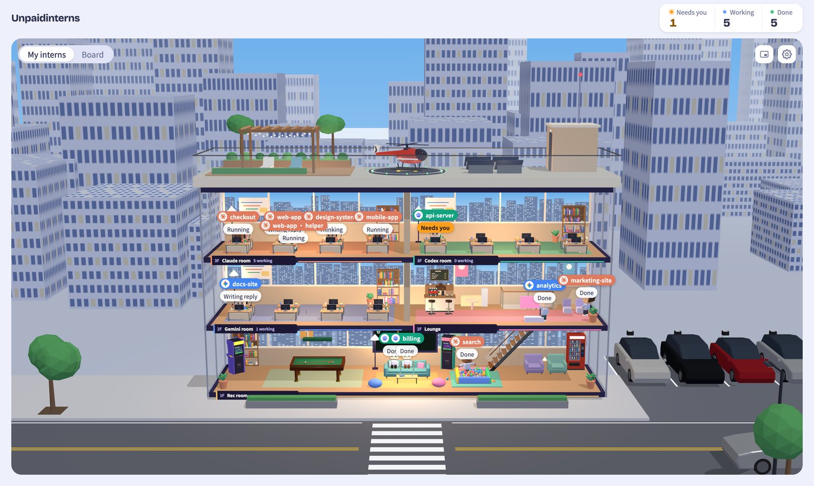
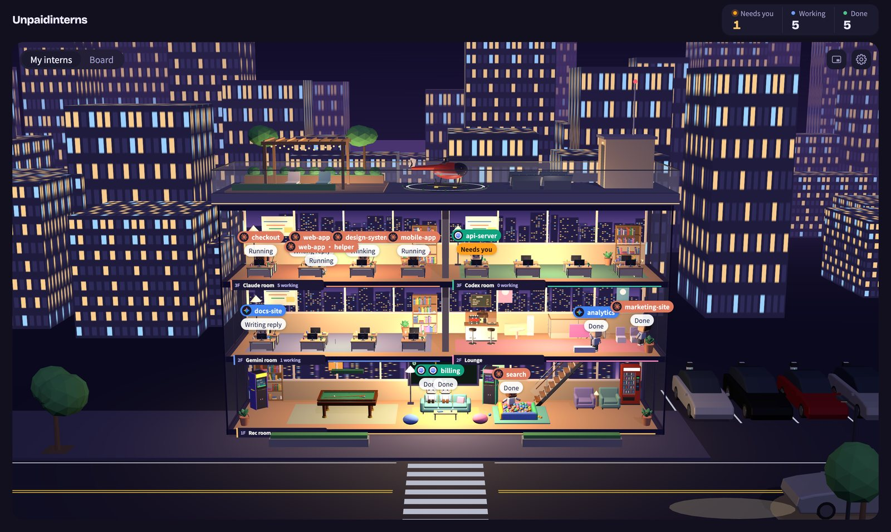
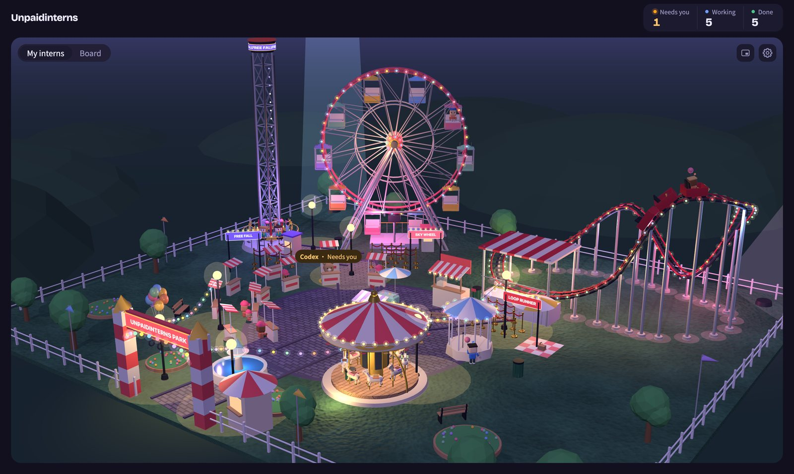
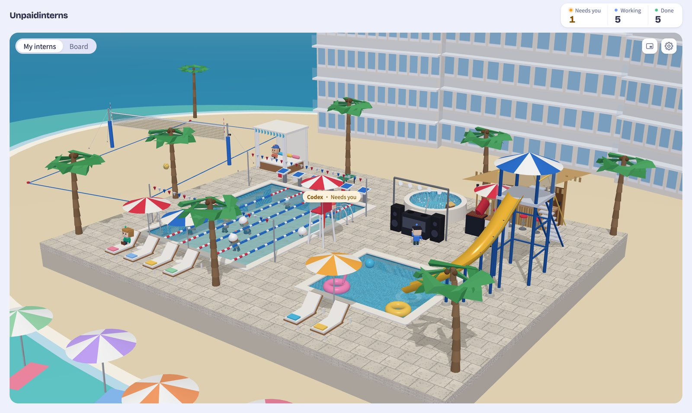
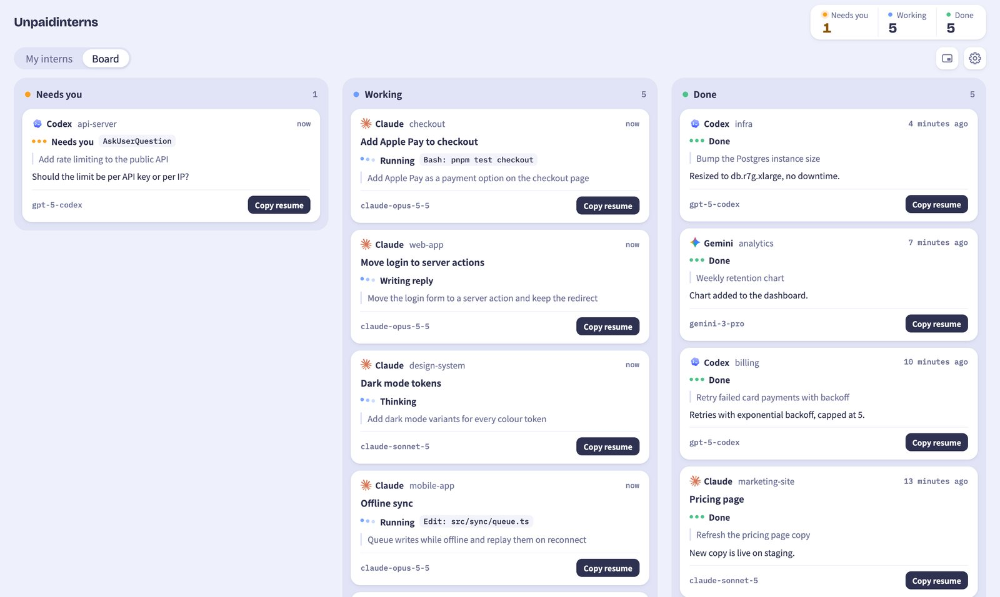
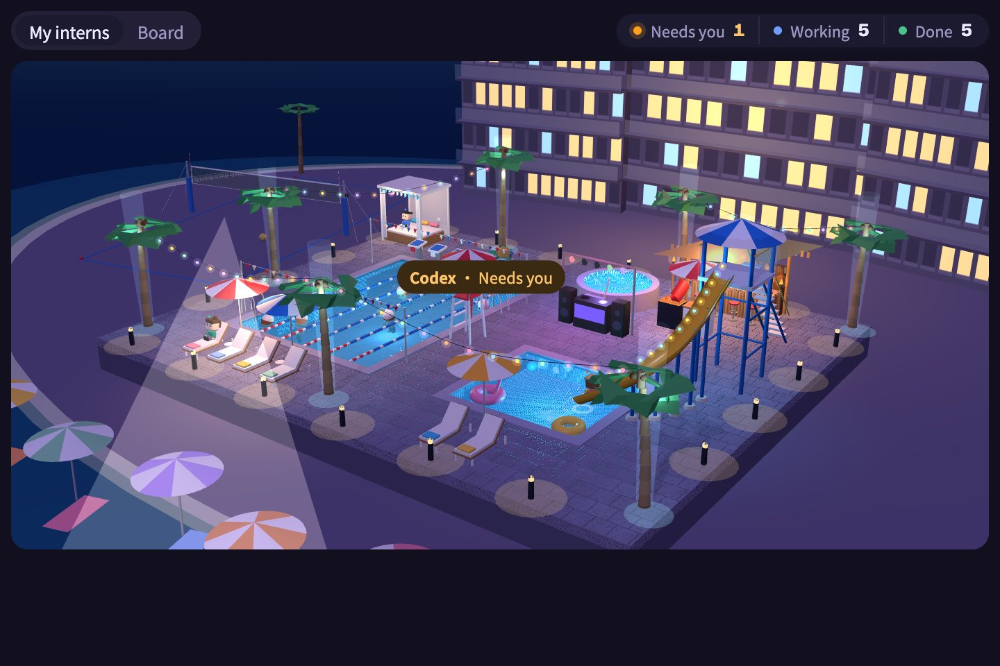

<div align="center">

# Unpaidinterns

**A tiny 3D world where your coding agents clock in.**

Every Claude Code and Codex session on your machine becomes a little intern: typing at a desk while it works,<br>
waving at you when it needs an answer, and wandering off to the coffee bar when it's done.

</div>

https://github.com/user-attachments/assets/a8d79f16-73a2-42be-a0dd-44b5329741d4

---

## Why

Run three or four agents at once and the terminal tabs blur together. Which one finished? Which one has been sitting on a question for ten minutes?

Unpaidinterns watches the session logs your agents already write and turns them into something you can read at a glance: who is working, who is waiting on you, and who is done. Leave it open on a second screen, or float it in a picture-in-picture window over your editor.

## What you get

<table>
<tr>
<td width="50%"></td>
<td width="50%"></td>
</tr>
<tr>
<td><b>The office.</b> A cut-away tower with a room per agent. Each session gets a desk and a name tag with its project.</td>
<td><b>Day and night.</b> One switch changes both the scene and the interface.</td>
</tr>
<tr>
<td></td>
<td></td>
</tr>
<tr>
<td><b>The theme park.</b> Idle interns ride the coaster, the ferris wheel, the carousel and the drop tower.</td>
<td><b>The pool club.</b> Working interns swim laps; the rest take the slide, the hot tub or a lounger.</td>
</tr>
<tr>
<td></td>
<td></td>
</tr>
<tr>
<td><b>The board.</b> The same sessions as cards, in three lanes: needs you, working, done.</td>
<td><b>Picture-in-picture.</b> A small always-on-top window that keeps watching while you work.</td>
</tr>
</table>

A few details worth knowing:

- **Hover any intern** to see its session card: project, task title, current tool, your last prompt and its last reply. Click to pin the card.
- **Copy resume** puts the command to reopen that exact conversation on your clipboard, for example `cd '/work/api' && claude --resume 7f3a…`.
- **Git worktrees** are grouped under their main project, so `api · fix-auth` sits with `api`.
- **Subagents** show up as smaller helpers standing next to the intern that started them.
- The three counters in the top-right corner count each intern once; helpers are counted with the intern they belong to.

## Quick start

You need **Node 22 or newer** and **pnpm 10**.

### As a Claude Code plugin

```sh
claude plugin marketplace add JulianWangHZ/Unpaidinterns
claude plugin install unpaidinterns@unpaidinterns
```

Then, in any Claude Code session, type `/unpaidinterns:open` or just ask Claude to *open the intern dashboard*. The first run fetches and builds the app (about a minute), starts it in the background and opens your browser, already signed in.

The same command takes an action:

| Command | What it does |
|---|---|
| `/unpaidinterns:open` | Start the dashboard and open it |
| `/unpaidinterns:open demo` | Start it with made-up sessions |
| `/unpaidinterns:open restart` | Restart, with a fresh sign-in link |
| `/unpaidinterns:open stop` | Shut it down |
| `/unpaidinterns:open status` | Is it running, and which version |
| `/unpaidinterns:open update` | Pull the latest version and rebuild |

### From source

```sh
git clone https://github.com/JulianWangHZ/Unpaidinterns.git
cd Unpaidinterns
pnpm install
pnpm build
pnpm start
```

The server prints a one-time link:

```
Unpaidinterns is running. Open this link once to sign in:
http://127.0.0.1:4777/api/auth?token=…
```

Open it in your browser. That's it: any Claude Code or Codex session you start from now on walks into the office.

**Just want to look around?** `pnpm start --demo` fills the office with made-up sessions that change state every few seconds, no agents needed.

## How it works

```
~/.claude/projects/**/*.jsonl ─┐
                               ├─▶ collector ─▶ local server ─▶ browser
~/.codex/sessions/**/*.jsonl  ─┘   (tails logs)  (127.0.0.1)    (3D + board)
```

The collector follows the session logs that Claude Code and Codex already write to your home folder and reads each new line as it lands. It never writes to those files and never talks to the agents themselves.

A session moves between three groups:

| Group | What the intern does | Comes from |
|---|---|---|
| **Working** | Sits at its desk, typing or thinking | thinking, running a tool, writing a reply |
| **Needs you** | Stands up, waves, and a ring pulses under it | waiting for your answer or approval, or an error |
| **Done** | Wanders off to the lounge, the rides or the pool | finished, interrupted, or idle |

Sessions with no new activity for 30 minutes leave the building on their own.

## Privacy and security

- **Everything stays on your machine.** The server only listens on `127.0.0.1`, and nothing is sent anywhere else.
- **Sign-in is required, even locally.** The link printed at start-up works once and swaps itself for a browser cookie, so other local apps can't read your sessions.
- **Read-only.** Your agents' logs are read, never changed.

## Settings

The gear in the top-right corner has everything:

| Setting | Options |
|---|---|
| Scene | Office, Theme park, Pool |
| Appearance | Day, Night |
| Show agents | Turn Claude, Codex or Gemini on or off |
| Language | English, 中文 |

The picture-in-picture button sits next to the gear. It needs Chrome or Edge 116 or newer.

These environment variables change the defaults:

| Variable | Default | What it does |
|---|---|---|
| `UNPAIDINTERNS_DATA_DIR` | `~/.unpaidinterns` | Where the app keeps its own data |
| `UNPAIDINTERNS_TOKEN` | random | A fixed sign-in token, handy for scripts |

Pick another port with `pnpm start --port 5000`.

## Supported agents

| Agent | Status |
|---|---|
| Claude Code | Supported: live sessions, subagents and worktrees |
| Codex CLI | Supported: live sessions and worktrees |
| Gemini CLI | Coming soon: it already has a room in the office |

## Troubleshooting

**"This link is invalid or was already used."** Each link works once. Restart with `pnpm start` to get a new one, or set `UNPAIDINTERNS_TOKEN` to keep the same link.

**The office is empty.** Only sessions active in the last 30 minutes appear. Send your agent a message and it walks in within a few seconds. If the server says `Claude Code: not installed`, it couldn't find `~/.claude/projects`.

**The picture-in-picture button is greyed out.** Your browser doesn't support it yet; use Chrome or Edge 116 or newer.

## Development

```sh
pnpm dev         # server and web app with hot reload, at http://localhost:5173
pnpm test        # unit tests
pnpm coverage    # unit tests with a coverage report
pnpm e2e         # end-to-end tests in your installed Chrome
pnpm typecheck
```

The repo is a small pnpm workspace:

- `packages/core`: the shared session and event types
- `packages/collector`: tails agent logs and turns lines into events
- `packages/server`: the local HTTP and WebSocket server
- `apps/web`: the React and three.js app
- `plugin`: the Claude Code plugin and its launcher script

## License

[MIT](LICENSE)
